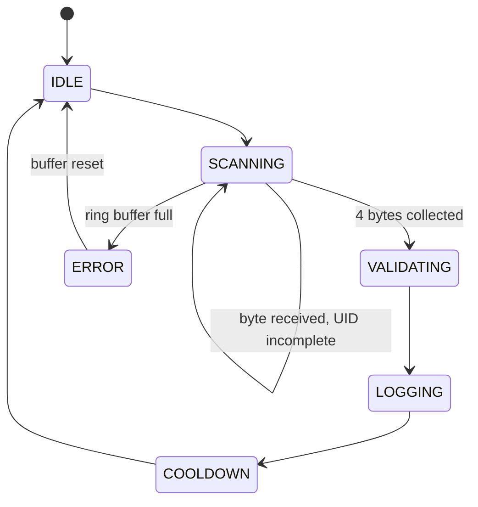

# RFID Access Logger

An embedded-style C program that reads 4-byte RFID tag IDs, decides whether each scan is **granted**, **denied** or a **duplicate**, and records every scan in a binary log file.

It was built as the capstone of a 14-day embedded C sprint. The reader is simulated over `stdin`: each keystroke stands in for one byte arriving on a UART, so the whole receive path (ring buffer, state machine, whitelist, log) runs exactly as it would on a microcontroller, minus the hardware.

## Features

- **Byte-at-a-time receive path** through a fixed-size ring buffer, with an explicit overflow policy
- **Function-pointer state machine** (`IDLE → SCANNING → VALIDATING → LOGGING → COOLDOWN`)
- **Whitelist stored in a binary file**, created on first run, editable at runtime
- **Debounce:** the same tag scanned again within a cooldown window is flagged as a duplicate
- **Persistent log** of fixed-size binary records, with the outcome packed into a single status byte
- **Command menu:** dump the log, add a tag, clear the log
- **No heap allocation**, C99, builds warning-free with `gcc -Wall -Wextra`

## How it works



Each state handler runs once per loop iteration and **returns the next state**. `main()` calls it through a dispatch table, so the loop is just:

```c
while (scan_ended == false) {
    current_state = sp[current_state]();
}
```

`SCANNING` runs once per *byte*, not once per UID. Bytes are pushed into the ring buffer as they arrive, and once four are queued they are popped out as one tag ID. When input ends (EOF, or `q` typed as a test quit key) the loop stops.

## Project layout

| File | Role |
|------|------|
| `tags.h` | Shared types, constants and function declarations |
| `reader.c` | `scan_input()` (the UART stand-in) and the ring buffer |
| `state.c` | State handlers, whitelist, log file, and the command-mode functions |
| `main.c` | Command menu, then the scan loop |

## Data model

| Type | Contents |
|------|----------|
| `tag` | 4 raw UID bytes + a 20-char label (one whitelist entry) |
| `log_entry` | 4 UID bytes + `uint32_t` tick timestamp + 1 status byte |
| `ringBuf` | 8-byte array, read/write pointers, and a `full` flag |

Outcome flags share the single `statusbyte`:

| Flag | Value | Meaning |
|------|-------|---------|
| `FLAG_GRANTED` | `0x01` | UID is on the whitelist |
| `FLAG_DENIED` | `0x02` | UID is not on the whitelist |
| `FLAG_DUPLICATE` | `0x04` | Same tag as the previous scan, within `COOLDOWN_TICKS` |
| `FLAG_ERROR` | `0x08` | Reserved, not used yet |

## Design decisions

- **UIDs are `uint8_t[4]`, not `char[]`.** `0x00` is a legal byte inside a UID, and string functions would silently truncate at it. Unsigned, fixed-width types also keep comparisons and bit operations well-defined.
- **The ring buffer stores raw bytes, not assembled UIDs.** A UART delivers one byte at a time and its interrupt handler can't block waiting for the rest of a tag. Assembly therefore happens on the consuming side, in the `SCANNING` state.
- **Reject-new, not overwrite-oldest.** Every byte belongs to a UID, so silently discarding the oldest one would corrupt a tag ID and could grant or deny the wrong card. A full buffer is reported to the caller instead.
- **A `full` flag resolves empty vs. full.** `rd_ptr == wr_ptr` is true in both cases, so the pointers alone can't tell them apart.
- **Sentinels live outside the byte range.** `scan_input()` returns `int` so `EOF` (-1) can't be confused with a real byte, and `ringBufRead()` returns `RINGBUF_EMPTY` (-1) the same way.
- **No pointers inside stored structs.** `tag` and `log_entry` use fixed-size arrays, so they can be written with `fwrite` and read back with `fread` directly. A stored pointer would be meaningless on the next run.
- **Status flags share one byte.** Each fact gets its own bit and is set by OR-ing it in. The byte is cleared at the start of every scan, because `pending_entry` is `static` and would otherwise carry flags over from the previous scan.
- **Debounce state updates only on non-duplicate scans.** If duplicates refreshed the timestamp, a card resting on the reader would keep resetting its own cooldown and it would never expire.
- **Encapsulation.** State lives in `static` variables inside `state.c`. `main.c` sees only the functions and `scan_ended`, so it can't bypass the ring buffer's rules.
- **Recoverable vs. fatal errors.** A log file that won't open at startup is fatal (`exit(1)`), since there is nowhere to record scans. A full ring buffer only spoils one scan, so `STATE_ERROR` resets the buffer and carries on.
- **`STATE_` prefix on the enum.** A bare `ERROR` collides with a macro in some system headers.
- **Everything is sized at compile time**, so there is no `malloc` and no heap to run out of on a small MCU.

## Build and run

```bash
gcc -Wall -Wextra -o rfid_logger main.c state.c reader.c
./rfid_logger
```

In Code::Blocks: create a *Console application* (C), add the four files, and build.

`whitelist.dat` and `log.dat` are created in the working directory on first run. They are generated at runtime, so keep them out of version control.

## Using it

The menu appears on startup:

```
1: Dump log
2: Add tag
3: Clear log
4: Start scanning
5: Close program
```

Because input is simulated, **a UID is four typed characters** stored as their ASCII codes. The default whitelist is:

| Type this | Tag |
|-----------|-----|
| `ABCD` | Alice |
| `EFGH` | Bob |
| `WXYZ` | Charles |

While scanning, type `q` (or send EOF: Ctrl+Z then Enter on the Windows console, Ctrl+D on Linux/macOS) to stop.

> **Input quirk.** `stdin` is line-buffered, so pressing Enter also delivers a `'\n'` byte, which the system treats as the first byte of the next UID. When testing interactively, type several tags on one line, or feed input from a pipe as below. Real UART hardware has no equivalent of this.

### Scripted example

```bash
printf '4\nABCDABCDEFGHQQQQ' | ./rfid_logger    # menu option 4, then 16 bytes = 4 tags
printf '1\n5\n' | ./rfid_logger                 # dump the log, then quit
```

(No trailing newline in the first `printf`, otherwise it would become a stray byte.)

The log then contains:

| # | UID (hex) | Result |
|---|-----------|--------|
| 1 | `41 42 43 44` | Granted (Alice) |
| 2 | `41 42 43 44` | Duplicate (same tag, one tick later) |
| 3 | `45 46 47 48` | Granted (Bob) |
| 4 | `51 51 51 51` | Denied (not on the whitelist) |

The scan loop currently also prints a prompt per byte and a debug status number per scan (`1` granted, `2` denied, `4` duplicate).

## Known limitations

Documented rather than hidden, and the next hardening pass:

- **Unused whitelist slots can match.** `is_authorized()` scans all `WHITELIST_SIZE` slots, including zero-filled unused ones, so a UID of `00 00 00 00` would be granted. It should stop at `whitelist_count`.
- **`whitelist_count` isn't restored on restart.** It resets to 3, so the next `add_tag()` after a restart would overwrite a previously added tag.
- **Error handling is incomplete.** Several `fopen` calls, `fread`/`fwrite` results, the menu `scanf`, and EOF during `add_tag()` are unchecked.
- **Stale whitelist file.** Changing `WHITELIST_SIZE` requires deleting `whitelist.dat` so it is regenerated at the new size.
- **Binary files aren't portable.** They are raw struct dumps, so the layout depends on compiler padding and byte order (`log_entry` is 12 bytes on the tested build: 9 of data plus 3 of padding).
- **Placeholders.** Timestamps are a tick counter rather than real time, and `COOLDOWN` doesn't delay yet.
- **Cosmetic.** `dump_log()` output is unformatted, the debug `printf` in `state_validating()` should be removed or gated, and `state_scanning()` uses a literal `4` where `UID_BYTE` belongs.

## Porting to real hardware

- Replace `scan_input()` with a UART receive interrupt that calls `ringBufWrite()`. The buffer is already byte-oriented, but the shared pointers would need `volatile` and interrupt-safe access.
- Replace the `system_tick` counter with a hardware timer or RTC, and give `COOLDOWN` a real hold-off.
- Move the whitelist and log from files to EEPROM or flash. The fixed-size structs map onto that directly.
